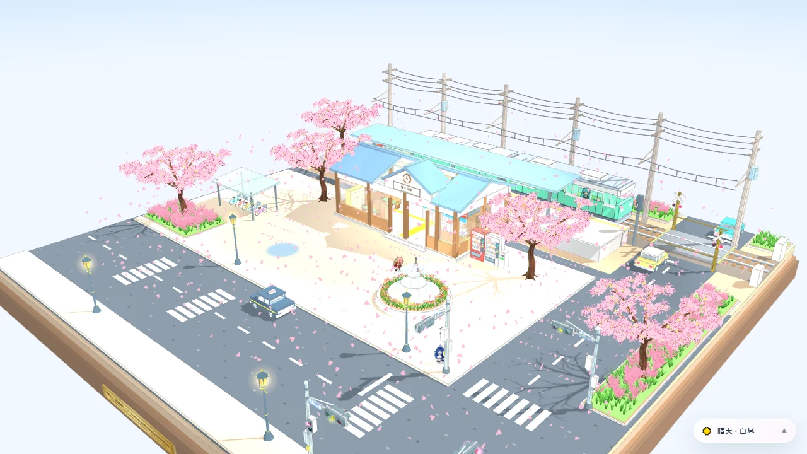
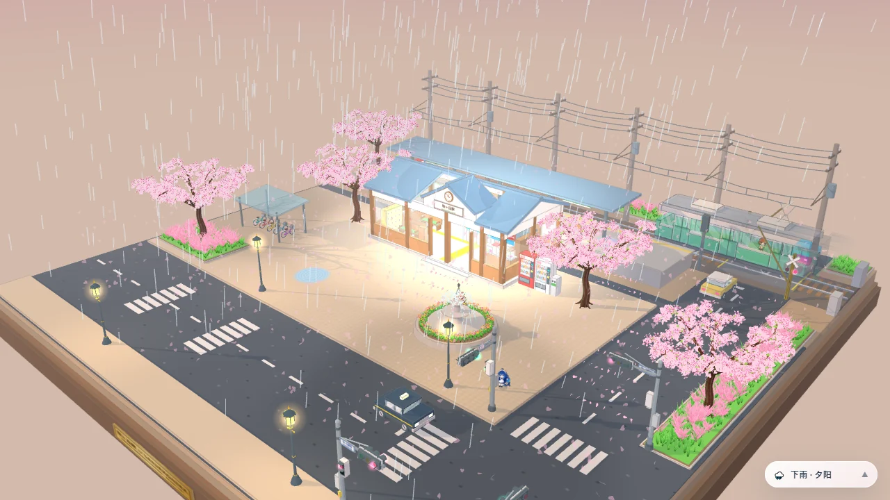
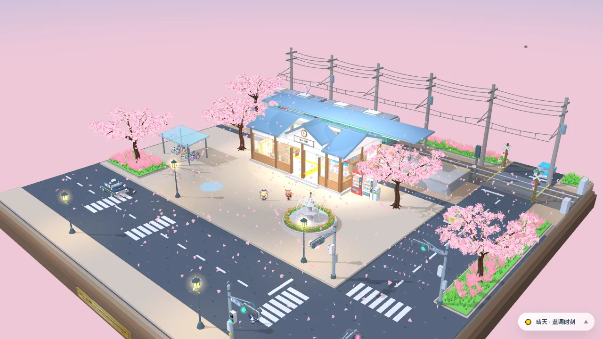
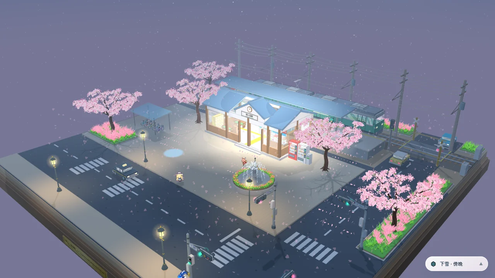

# 🌸 桜ヶ丘駅 · 日式樱花车站 3D 微缩景观

<p align="center">
  <a href="https://bruegmansmedick-cyber.github.io/sakuragaoka-station-diorama/"></a>
  <a href="https://github.com/bruegmansmedick-cyber/sakuragaoka-station-diorama/releases/latest"></a>
  
  
  
  
</p>

<p align="center">
  <a href="https://bruegmansmedick-cyber.github.io/sakuragaoka-station-diorama/">
    
  </a>
</p>

> **在线体验：** [bruegmansmedick-cyber.github.io/sakuragaoka-station-diorama](https://bruegmansmedick-cyber.github.io/sakuragaoka-station-diorama/)

**「桜ヶ丘駅」** 是一个基于 WebGL / Three.js 的日式春日车站三维微缩景观。没有外部 `.glb` / `.obj` 模型，建筑、樱花树、列车、人物动线、街道设施和动态光影都由程序生成。它既可以直接在浏览器里自由旋转观赏，也可以切换天气和时段，并封装成常驻桌面一角的 Electron 桌景挂件。

## 核心亮点

- **三渲二动画质感**：4 阶卡通色阶、几何墨线、柔和云影、动态水洼与樱花粒子。
- **可进入观察的微缩世界**：透明车站内部、小卖部、检票口、自动贩卖机、双节电车与街道细节。
- **五条角色动线**：候车、检票、登车、过街、打车与拍照，角色会随 30 秒场景周期推进。
- **天气与时段自由组合**：晴天、下雨、下雪，搭配白昼、夕阳、蓝调时刻与傍晚。
- **纯粹的场景交互**：左键旋转、右键平移、滚轮缩放，只在右下保留可收拢的氛围控制胶囊。
- **可选桌面形态**：Electron 无边框窗口、顶部悬停拖拽条、系统托盘菜单和快捷键。
- **静态网站友好**：单页入口、本地依赖、GitHub Pages 可直接托管。

## 在线体验

打开 [GitHub Pages 在线版](https://bruegmansmedick-cyber.github.io/sakuragaoka-station-diorama/) 即可体验。

| 操作 | 效果 |
| --- | --- |
| 鼠标左键拖拽 / 单指拖动 | 360° 环绕观察 |
| 鼠标右键拖拽 | 平移观察中心 |
| 滚轮 / 双指捏合 | 拉近或拉远 |
| 点击右下氛围胶囊 | 切换天气与时段 |

完整角色立绘从 [Awesome Codex Pet](https://github.com/legeling/awesome-codex-pet) 在线加载。网络不可用时会退回程序化彩色剪影，建筑与列车动画仍可运行。

## 场景氛围

天气和时段是两组独立选项，可以任意搭配，例如“夕阳 + 下雨”或“傍晚 + 下雪”。切换过程会平滑调整天空、环境光、阴影方向、雾效、路灯、室内照明与星空，页面会记住上一次选择。

| 夕阳 · 下雨 | 蓝调时刻 · 晴天 | 傍晚 · 下雪 |
| --- | --- | --- |
|  |  |  |

- **天气**：晴天、下雨、下雪。雨天有斜向雨线、更浓的雾和更亮的灯光；雪天有缓慢飘落的雪花与冷色空气感。
- **时段**：白昼、夕阳、蓝调时刻、傍晚。夜间会显示星空，并增强车站、自动贩卖机和街灯的照明。

## 本地运行

下载或克隆仓库后，在项目根目录启动任意静态文件服务器：

```bash
python -m http.server 8080
```

然后访问 <http://127.0.0.1:8080/>。

> 不建议直接双击 `index.html`：部分浏览器会限制本地文件的跨域图片加载。静态服务器可以避免这类差异。

## Electron 桌面桌景

### 环境要求

- Node.js 22.12 或更高版本
- npm
- 支持 WebGL 的显卡与浏览器环境

### 启动

```bash
npm install
npm start
```

不愿自行构建时，也可以从 [GitHub Releases](https://github.com/bruegmansmedick-cyber/sakuragaoka-station-diorama/releases/latest) 下载 Windows 便携版或安装包。

窗口默认出现在主屏幕右下角，并保持置顶。鼠标移到窗口最上方边缘时，会浮现半透明的拖拽条；场景其余区域仍用于旋转和缩放。

### 托盘与快捷键

| 功能 | 操作 |
| --- | --- |
| 显示 / 隐藏 | 单击系统托盘图标，或 `Ctrl/Cmd + Shift + S` |
| 始终置顶 | 托盘菜单，或 `Ctrl/Cmd + Shift + T` |
| 重置 3D 视角 | 顶部拖拽条按钮、托盘菜单，或 `Ctrl/Cmd + Shift + R` |
| 退出 | 托盘菜单，或 `Ctrl/Cmd + Shift + Q` |
| 窗口尺寸 | 迷你 380、标准 560、展台 780、大屏 1024 × 768 |
| 锁定位置 | 托盘菜单；锁定后顶部拖拽条隐藏，避免误移动 |
| 切换天气 | 托盘菜单 → 天气 |
| 切换时段 | 托盘菜单 → 场景时段 |

窗口位置与尺寸会保存在 Electron 的用户数据目录。关闭按钮默认把桌景隐藏到托盘，而不是直接结束进程。

### 打包

```bash
# 当前平台默认目标
npm run dist

# Windows：便携版与 NSIS 安装包
npm run build:win

# macOS：DMG
npm run build:mac

# Linux：AppImage
npm run build:linux
```

输出位于 `dist/`。通常应在对应操作系统上构建对应安装包；未配置代码签名的 Windows / macOS 安装包可能触发系统的未知发布者提示。

## 作为动态壁纸

### Lively Wallpaper

1. 安装开源免费的 [Lively Wallpaper](https://www.rocksdanister.com/lively/)。
2. 选择“添加壁纸”，导入本仓库的 `index.html`，或在本地静态服务器运行时填写网页地址。
3. 开启鼠标交互，即可在桌面直接旋转和缩放景观。

### Wallpaper Engine

可在 Wallpaper Engine 中新建网页类型壁纸，并指向本项目的在线地址或本地静态服务器地址。不同版本对鼠标交互和 WebGL 前台帧率的处理可能不同。

## 技术架构

```text
┌─ 表现与着色器层 ─────────────────────────────────────────────┐
│ 4 阶 Toon Gradient · 墨线轮廓 · 云影 · 玻璃与水面 Shader      │
│ 列车边界裁剪 · 距离淡出 · 植被顶点摆动 · 天空/雾效过渡         │
├─ 程序化建模与合批层 ─────────────────────────────────────────┤
│ CatmullRomCurve3 树枝 · 心形花瓣 · Canvas 2D 过程纹理         │
│ 静态网格按材质合批 · InstancedMesh 草丛 / 花瓣 / 水珠         │
├─ HD-2D 精灵与特效层 ─────────────────────────────────────────┤
│ 精灵图集扫描 · 左右朝向与跑跳帧 · 透明材质剪影阴影             │
│ 烟尘、速度线、音符、电弧、快门闪光对象池                      │
├─ 天气与时段系统 ─────────────────────────────────────────────┤
│ 雨线 / 飘雪粒子 · 动态雾 · 星空 · 多套光照与灯光参数           │
└─ 30 秒确定性场景状态机 ──────────────────────────────────────┘
  列车进出 · 车门开闭 · 道口栏杆 · 三色信号灯 · 角色防碰撞寻路
```

项目在浏览器中把 Three.js r128 作为本地依赖加载；角色素材按上游许可证在线获取。Electron 侧启用了 `contextIsolation`、沙箱与最小化 IPC 接口，网页内容不直接获得 Node.js 权限。

## 五位角色

| 角色 | 场景动线 |
| --- | --- |
| 初音未来 | 在站台等候，车门开启后与御坂美琴一同跑入车厢落座 |
| 御坂美琴 | 从西侧检票口进站，展示硬币与电弧动作后登车 |
| DeepSeek 鲸鱼娘 | 等待行人绿灯，沿斑马线穿过站前十字路口 |
| 菲比 | 穿过站前广场招手打车，后门开启后坐入出租车离开 |
| 莉奈娅 | 在广场三脚架相机旁取景，按下快门并触发闪光 |

## 项目结构

```text
sakuragaoka-station-diorama/
├── index.html                 # 单页 3D 场景与动画
├── vendor/                    # Three.js r128 本地依赖
├── main.js                    # Electron 主进程、托盘与窗口控制
├── preload.js                 # 最小化 IPC 桥接
├── package.json               # 启动与跨平台打包配置
├── assets/                    # 氛围预览图、应用图标与托盘图标
├── THIRD_PARTY_NOTICES.md     # 第三方依赖与角色素材说明
├── LICENSE                    # 项目代码 MIT 许可证
└── README.md
```

## 已知限制

- 完整角色贴图依赖外网；离线时会显示程序化剪影。
- 透明无边框窗口在不同桌面环境和显卡驱动下可能有细微差异。
- 移动端可以使用触控旋转与缩放，但性能和显示比例取决于设备。
- 本项目没有进行商业用途授权审查。拟商业使用前，请替换或重新授权角色素材，并自行核对角色知识产权。

## AI 协同创作署名

根据用户提供的项目材料：

- **Google Gemini**：初始三维程序化建模、GLSL 三渲二着色器、粒子系统、场景逻辑与封装草稿。
- **DeepSeek**：部分静态网格合批优化、街景道具和协同修订。
- **Awesome Codex Pet**：角色动态立绘资产来源。

本项目由 AI 生成内容与后续工程整理共同完成；代码可维护性、可部署性与桌面封装由仓库贡献者继续整理。

## 许可协议

- **项目代码**：[MIT License](./LICENSE)
- **Three.js r128**：MIT，全文见 [`vendor/LICENSE.three.js.txt`](./vendor/LICENSE.three.js.txt)
- **角色图集**：来自 `legeling/awesome-codex-pet`，适用 [CC BY-NC 4.0](https://creativecommons.org/licenses/by-nc/4.0/)，仅限非商业用途；详细署名见 [THIRD_PARTY_NOTICES.md](./THIRD_PARTY_NOTICES.md)

本项目是非官方同人作品，不代表或关联上述角色与素材的权利方。

## 贡献

欢迎提交 Issue 或 Pull Request，尤其是：

- 移动端与低性能设备的自适应优化
- 角色图集加载失败时的更清晰提示
- Electron 在 Windows、macOS、Linux 上的兼容性修复
- 静态素材本地化与许可证兼容方案

<details>
<summary><strong>展开：场景复现提示词（节选）</strong></summary>

```text
请使用 Three.js 制作一个单文件 HTML 的日式火车站三维微缩场景。

场景放置于正方形胡桃木博物馆展台上，采用新海诚/京阿尼风格的明快白昼三渲二美术，包含 4 阶卡通光影、墨线轮廓、柔和阴影与动态云影。支持鼠标和触控自由旋转、平移、缩放，画面中不放置常驻 UI。

中心为切妻破风式「桜ヶ丘駅」站房，包含透明候车室、售票机、路线票价表、储物柜、自动检票口、KIOSK 小卖部、冷热饮自动贩卖机和实时圆形时钟。场景内还有双节全透视通勤电车、真实工字钢轨、枕木、道砟、切轨道口、三色铁路信号灯、灌木、粉黛乱子草、日式路灯、喷泉花坛和站前三脚架相机。

围绕底座布置写实染井吉野樱、飘落花瓣、十字路口、斑马线、自动贩卖机、出租车和自行车。通过 30 秒确定性状态机串联列车进出、车门开闭、道口栏杆、信号灯与角色走位。

接入 Awesome Codex Pet 的 HD-2D 动态角色图集，布置初音未来、御坂美琴、DeepSeek 鲸鱼娘、菲比与莉奈娅五条生活动线，并加入烟尘、速度线、音符、电弧和快门闪光等轻量特效。

增加可收拢的氛围控制面板，允许独立切换晴天、下雨、下雪与白昼、夕阳、蓝调时刻、傍晚。切换时平滑更新天空渐变、太阳方向、环境光、雾效、星空、街灯和室内照明，并记住用户最后一次选择。
```

</details>

---

如果这个场景让你想起了某个春日车站，欢迎点亮 Star，或把它改成属于你的桌面世界。
